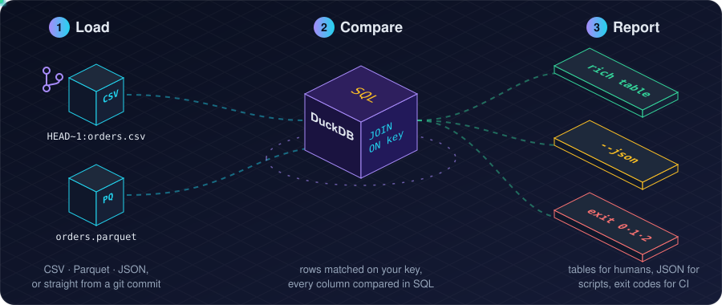
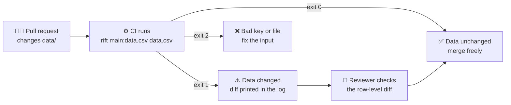

<p align="center">
  
</p>

<p align="center">
  
  
  
  
  
</p>

<p align="center"><b>Think <code>git diff</code>, but for tables.</b><br>
Point rift at two versions of a dataset and it tells you which rows were <b>added</b>, which were <b>removed</b>, and exactly which values <b>changed</b>, all on your own machine.</p>

---

## Why rift?

Code changes get reviewed line by line. **Data changes usually don't.** A CSV export is regenerated, a SQL model is refactored, a price list is updated, and the only check is "the row count looks about right."

rift shows you what actually changed:

- 🔍 **Row-level answers.** Not just "3 rows differ": you see *which* rows and *which* columns, with before → after values.
- 🏠 **Local-first.** Your data never leaves your laptop. No server, no account, no upload.
- ⚡ **Fast.** Both files are loaded into an in-memory [DuckDB](https://duckdb.org) database and compared with SQL, so millions of rows are fine.
- 🌿 **Git-aware.** Compare a file with any earlier commit: `rift HEAD~1:data.csv data.csv -k id`.
- 🤖 **CI-ready.** Exits like `diff`: `0` = identical, `1` = different, `2` = error. Add `--json` for machine-readable output.

## See it in action

<p align="center">
  
</p>

## How it works

<p align="center">
  
</p>

1. **Load.** rift reads each side into DuckDB. Either side can be a CSV, Parquet or JSON file, or a version of a file from git history (`REV:path`).
2. **Check the key.** The key column(s) you pass must exist on both sides and be unique and non-empty, so every row has exactly one partner.
3. **Compare.** rift joins the two tables on the key:
   - keys only in *after* → **added**
   - keys only in *before* → **removed**
   - keys on both sides where any column `IS DISTINCT FROM` its partner → **changed** (so `NULL` vs `NULL` correctly counts as equal)
4. **Report.** You get a colour table in the terminal, JSON with `--json`, and an exit code your scripts can act on. Added, removed and retyped columns are reported too.

---

## Real-world examples

### 🧾 "Did last night's CRM export silently drop customers?"

Your finance dashboard is fed by a nightly export. Today's revenue number looks odd.

```bash
rift exports/2026-11-15/customers.csv exports/2026-11-16/customers.csv -k customer_id
```

```text
  Removed        -1        ← Initech vanished from the export
  Changed        ~2        ← Globex: status active → churned, revenue 8500 → 0
```

Two minutes later you know whether it's a real churn or a broken export.

### 🛠️ "I refactored a SQL model. Is the output exactly the same?"

You rewrote a 400-line query to make it faster. The output should not change at all.

```bash
rift old_model.parquet new_model.parquet -k order_id --ignore _loaded_at
echo $?   # 0 → identical, ship it.  1 → look at the diff first.
```

`--ignore` skips columns that are *supposed* to differ, like load timestamps.

### 🛒 "Which prices am I about to change in the store?"

Merchandising sent a new price sheet. Before you upload it, check exactly what it changes:

```bash
rift prices_live.csv prices_new.csv -k sku --summary
```

```text
Changed values by column
 column       rows changed
 price                 412
 sale_price             37
```

412 price changes when you expected 40? Better to catch that now than after customers do.

### 🤖 "Why did my model's accuracy drop between training runs?"

Diff the feature tables from both runs, keyed on a composite key, and pipe the JSON into `jq`:

```bash
rift features_run41.parquet features_run42.parquet -k user_id,event_date --json \
  | jq '.column_change_counts'
```

```json
{ "avg_session_minutes": 120394, "country": 3 }
```

One feature changed for 120k users. That's your bug.

### 🌍 Multi-region tables with composite keys

The same `id` can exist in several regions? Combine columns into one key:

```bash
rift before.csv after.csv -k region,id
```

---

## Works with Git

Data files live in git repos too, and rift treats git history as a first-class source.

### Compare with any commit, branch or tag

Use git's own `REV:path` syntax (paths are relative to the repo root, or start with `./` for the current directory):

```bash
rift HEAD~1:data/customers.csv data/customers.csv -k customer_id     # what did my last commit change?
rift main:data/customers.csv data/customers.csv -k customer_id       # what does my branch change vs main?
rift v1.0:exports/users.parquet v2.0:exports/users.parquet -k id     # between two releases
```

### Use rift as your `git difftool`

```bash
git config --global difftool.rift.cmd 'rift "$LOCAL" "$REMOTE" --key id'
git difftool -y -t rift HEAD~1 -- data/customers.csv
```

### Catch data changes in pull requests



A minimal GitHub Actions job:

```yaml
name: data-diff
on: pull_request

jobs:
  rift:
    runs-on: ubuntu-latest
    steps:
      - uses: actions/checkout@v4
        with:
          fetch-depth: 0            # rift needs the main branch history
      - uses: actions/setup-python@v5
        with:
          python-version: "3.12"
      - run: pip install riftdiff
      - name: Show what this PR changes in the data
        run: rift origin/main:data/customers.csv data/customers.csv -k customer_id
        continue-on-error: true     # report the diff without failing the build
```

Remove `continue-on-error` if any data change should block the merge until someone signs off.

---

## Install

```bash
pip install riftdiff
```

Or from source:

```bash
git clone <this repo> && cd rift
python3 -m venv .venv && source .venv/bin/activate
pip install -e '.[dev]'
pytest
```

> **macOS + iCloud Desktop/Documents:** iCloud can mark files inside `.venv` as hidden, and Python then skips the `.pth` file that makes the editable install work (`ModuleNotFoundError: No module named 'riftdiff'`). Create the venv as `.venv.nosync` (iCloud ignores `*.nosync`) and symlink it: `python3 -m venv .venv.nosync && ln -s .venv.nosync .venv`.

## Usage

```
rift BEFORE AFTER --key COLUMN [options]
```

`BEFORE` and `AFTER` are file paths or git revisions (`HEAD~1:path/to/file.csv`).

| Option | What it does |
| --- | --- |
| `-k, --key COLUMN` | Column that identifies a row. Repeat it or comma-separate it for a composite key: `-k region,id`. |
| `-i, --ignore COLUMN` | Leave a column out of the comparison, e.g. `-i updated_at`. Repeatable / comma-separated. |
| `-n, --limit N` | Show at most N rows per section (default 10; `0` shows all). Counts are always exact. |
| `--summary` | Print only the counts, schema changes and per-column totals. |
| `--json` | Print the full diff as JSON for scripts and CI. |
| `--version` | Print the version. |

**Supported formats:** CSV/TSV (`.csv`, `.tsv`, `.txt`), Parquet (`.parquet`, `.pq`) and JSON (`.json`, `.jsonl`, `.ndjson`), optionally compressed with `.gz` or `.zst`. The two sides may be different formats.

### What rift reports

| | Meaning |
| --- | --- |
| 🟢 **Added** | Keys that exist only in `AFTER` |
| 🔴 **Removed** | Keys that exist only in `BEFORE` |
| 🟡 **Changed** | Keys on both sides where at least one value differs, with before → after for each changed column |
| 📊 **By column** | How many rows changed in each column |
| 🧬 **Schema** | Columns added, removed, or whose type changed. Retyped columns are compared by their text form, so `10` and `"10"` count as equal. |

rift refuses keys that are missing, empty or not unique, because a diff on those would be misleading.

### Exit status

| Code | Meaning |
| --- | --- |
| `0` | No differences |
| `1` | Differences found |
| `2` | Error (missing file, bad key, unreadable data…) |

## Python API

```python
from riftdiff import diff

result = diff("HEAD~1:data/orders.csv", "data/orders.parquet",
              key_column=["region", "order_id"],
              ignore_columns=["updated_at"], limit=100)

result.summary()          # {'rows_before': ..., 'rows_added': ..., ...}
result.added              # list of row dicts
result.removed            # list of row dicts
for change in result.changed:
    print(change.key, change.changes)   # {'region': 'EU', 'order_id': 7} {'total': (120, 135)}
result.has_differences    # bool
result.to_dict()          # JSON-ready dict
```

Problems with the input raise `riftdiff.RiftError` with a readable message.

## Try it now

The repo includes a small example:

```bash
rift examples/customers_before.csv examples/customers_after.csv -k customer_id
```

## License

[MIT](LICENSE)
